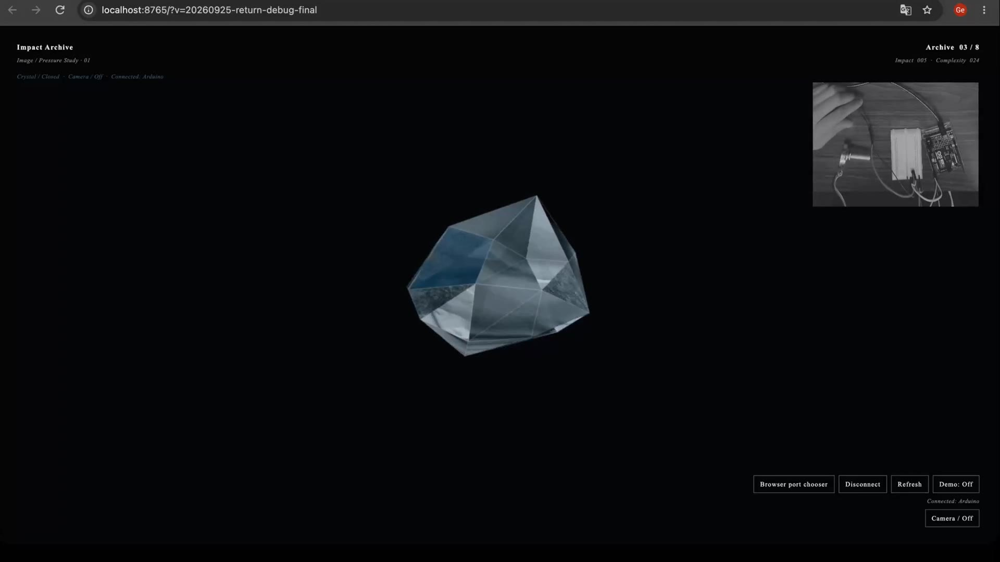

# Impact Archive

**Live site:** https://huanggedv.github.io/impact-archive/
**Article:** [Lab 4 — Impact Archive: When Pressure Becomes Memory](https://medium.com/@chloe_huang_19782/lab-4-impact-archive-when-pressure-becomes-memory-8a1ecf3f09d3)

An Arduino + p5.js instrument for the **Sensing: Force sensors and photocells** assignment.

> A physical press preserves a moment as a fragile glass fragment. Present camera frames and Tongji memories share one archive.

The new visual direction takes the faceted, photographic feeling of the OpenProcessing reference as a starting point and turns it into a small black-screen memory instrument. Photographs from the artist's second year at Tongji University's College of Design and Innovation form the past archive. When the camera is enabled, the present face becomes the newest image. The images are mapped onto an asymmetric, sharp-edged glass shard with drifting vertices, diagonal cuts, and sparse specular highlights. Each press saves one frame, adds structural complexity, and plays a short percussive sound in the browser.

## Folder map

```text
02-sensing-force-photocells-pressure-landscape/
├── arduino/
│   └── pressure_landscape.ino   # reads FSR + potentiometer
├── p5js/
│   ├── index.html                # local preview page + libraries
│   ├── sketch.js                 # memory crystal + camera + serial parser + audio
│   ├── style.css
│   └── media/
│       └── memories/             # Tongji campus memory photographs
├── docs/
│   ├── assignment-brief.md       # handout requirements vs project decisions
│   └── wiring.md                 # circuit and physical object instructions
└── media/                        # process photos / documentation
```

## Interaction mapping

| Physical input | Digital role | Visible / audible result |
| --- | --- | --- |
| FSR press or tap | archive a moment + cumulative complexity | each distinct hit stores the current camera frame (or one Tongji memory in demo mode), adds more faces and asymmetry, and plays a short click |
| potentiometer | memory depth / glass tension | low values favor the newest frame; high values reveal older snapshots and campus memories while changing rotation and facet tension |
| releasing the FSR | recovery | the impact settles while the accumulated structure remains, then slowly erodes |

The physical object can be a soft fabric or foam pad over the FSR. A small rigid disk under the pad concentrates the force, so the hand feels like it is striking a surface rather than operating a tiny sensor. Put the potentiometer beside it as a rotary **tension** control.

## Demo video

[](https://huanggedv.github.io/impact-archive/media/impact-archive-demo.mp4)

▶ [Watch the demo (2:25)](https://huanggedv.github.io/impact-archive/media/impact-archive-demo.mp4) · [download MP4](media/impact-archive-demo.mp4) — the piece running with the Arduino FSR and potentiometer connected.

## Try it without Arduino (mouse / touch)

The website works on its own — the mouse stands in for the sensors:

| Mouse / keyboard | Stands in for | Result |
| --- | --- | --- |
| click or tap the canvas | FSR press | archives one memory (or a camera still if the camera is on), adds complexity, plays a click |
| hold the button down | pressing harder | the impact value keeps rising while held |
| click 3× within ~2 s | triple press | unfolds the postcard; the next click folds it back |
| scroll wheel or ↑ / ↓ | potentiometer | memory depth / glass tension |
| **C** or **CAMERA / OFF** | — | turns on the local camera (nothing is uploaded) |
| **D** | — | toggles the self-playing demo animation |
| **SPACE** | — | visual/audio impact test only |

When an Arduino is connected, the sensors take over again automatically.

## Run it with Arduino

1. Wire the FSR to A0 and the potentiometer wiper to A1 as shown in `docs/wiring.md`.
2. Upload `arduino/pressure_landscape.ino` to the Uno or Uno R4 Minima.
3. Close Arduino's Serial Monitor.
4. Start the p5 serial server. On the first use, install it in a separate folder:

   ```bash
   mkdir -p ~/p5-serialserver
   cd ~/p5-serialserver
   npm init -y
   npm install p5.serialserver
   node node_modules/p5.serialserver/startserver.js
   ```

   Leave this terminal window running. The server listens on port `8081`.
5. Open `p5js/index.html` through the local server. In Chrome or Edge, press `Connect` and choose the Arduino in the browser port picker; the page connects directly and does not need the p5 serial server. In Safari or another browser without Web Serial, wait for the port list, choose the Arduino port, and press `Connect` while the p5 serial server is running.

The Arduino sends lines such as:

```text
pressure:384,pot:721
```

If Chrome or Edge says `No port selected`, choose the USB Arduino in the browser dialog and allow the connection. If the page says `Serial server not found`, use Chrome/Edge direct connection or start the p5 serial server as shown above. If no port appears after the server starts, close Arduino's Serial Monitor, unplug and reconnect the Arduino, then press `Refresh`.

## Submission note

The assignment asks for a website URL. Use the local page while testing, then publish the p5.js sketch or deploy this `p5js` folder and submit that URL together with process photos of the pressure pad and Arduino wiring.
